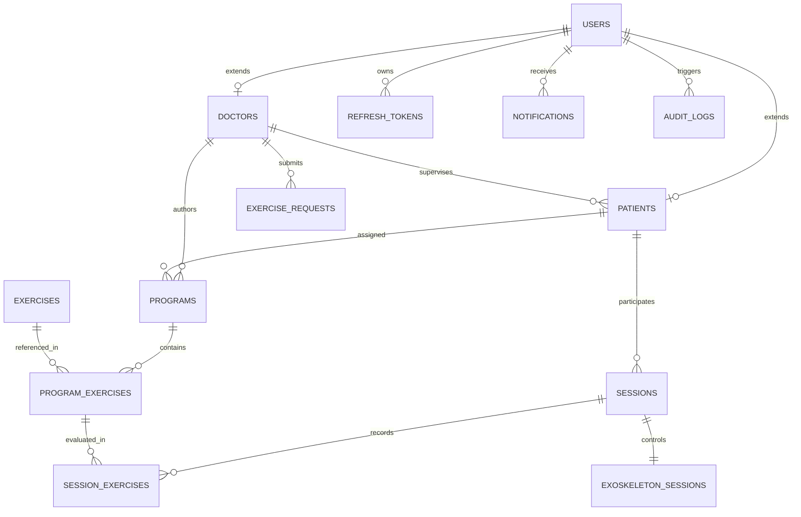
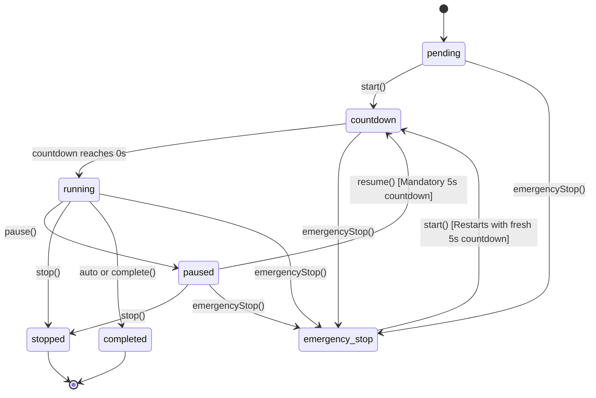

# MotionCare Backend Architecture and API Documentation

## 1. Executive Summary

MotionCare Backend is an enterprise-grade RESTful API and real-time communication server designed for the Pediatric Rehabilitation Exercise Assistant system. The platform orchestrates clinical workflows between physical therapists, pediatric patients, administrative personnel, and robotic rehabilitation exoskeleton hardware.

The service provides centralized authentication, patient profile management, customized exercise prescription programs, rehabilitation session tracking, hardware telemetry monitoring, interactive notifications, and an immutable audit logging pipeline.

---

## 2. System Architecture

The backend application follows a layered architectural pattern comprising:

* **Presentation Layer (HTTP & WebSockets):** Express.js routes and controllers coupled with Socket.io real-time broadcast namespaces and session rooms.
* **Middleware Layer:** Security filtering, JSON body parsing, CORS management, JWT signature validation, and Role-Based Access Control (RBAC) authorization guards.
* **Business Logic Layer (Services):** Domain logic handling credentials verification, token lifecycle management, exoskeleton state machine progression, session timers, and automated event notifications.
* **Hardware Abstraction Layer (MQTT Transport Stub):** Decoupled messaging interface configured to bridge high-level therapy commands and real-time telemetry between the backend server and physical exoskeleton actuators.
* **Data Access Layer (Models):** Promisified SQLite3 query interfaces executing parameterized SQL queries to safeguard against SQL injection vulnerabilities.
* **Database & Persistence:** SQLite database featuring transactional migration scripts and automatic data seeding.

---

## 3. Technology Stack and Dependencies

### Core Runtime and Framework
* **Runtime Environment:** Node.js (v18+ recommended)
* **Web Framework:** Express.js 4.x
* **Real-Time Communication:** Socket.io 4.8.x
* **Database Engine:** SQLite3 (Native driver with custom Promise wrapper)

### Security and Authentication
* **Token Management:** jsonwebtoken (JWT) 9.x (Dual-token architecture: short-lived access tokens and stored rotating refresh tokens)
* **Cryptographic Hashing:** bcrypt 5.x (Salt rounds: 10)
* **Cross-Origin Resource Sharing:** cors 2.x

### Utilities and Documentation
* **Environment Configuration:** dotenv 16.x
* **File Uploads:** Multer 2.x
* **API Documentation:** swagger-ui-express 5.0.x
* **Input Validation:** express-validator 7.x
* **Development Monitoring:** Nodemon 3.x

---

## 4. Repository Structure

```text
motioncare_backend/
├── .env                                  # Environment variables configuration
├── database.sqlite                       # SQLite database storage file
├── package.json                          # Node.js project manifest and dependency tree
├── package-lock.json                     # Deterministic dependency lockfile
├── README.md                             # Comprehensive technical documentation
├── uploads/                              # Static directory for uploaded exercise media
└── src/
    ├── app.js                            # Express application setup, middleware, and route mounting
    ├── server.js                         # HTTP server bootstrap, Socket.io initialization, and network listener
    ├── swagger.json                      # OpenAPI 3.0 specification definition
    ├── config/
    │   └── database.js                   # SQLite connection, Promise wrappers (run, get, all), and migration runner
    ├── controllers/
    │   ├── admin.controller.js           # Administrative CRUD, aggregated statistics, and fleet monitoring
    │   ├── auditLog.controller.js        # Audit trail querying and filtering
    │   ├── auth.controller.js            # Authentication handlers (login, register, refresh, logout)
    │   ├── dashboard.controller.js       # Therapist patient compliance and weekly progression metrics
    │   ├── exercise.controller.js        # Global rehabilitation exercise catalog handlers
    │   ├── exerciseRequest.controller.js # Custom exercise request lifecycle handlers
    │   ├── exoskeleton.controller.js     # Exoskeleton remote control endpoints (start, pause, stop, emergency)
    │   ├── notification.controller.js    # In-app notifications retrieval and read tracking
    │   ├── patient.controller.js         # Patient clinical profile management
    │   ├── program.controller.js         # Rehabilitation program builders and exercise assignments
    │   └── session.controller.js         # Session execution records and historical logs
    ├── database/
    │   ├── migrations/
    │   │   ├── 001_initial_schema.sql           # Base tables (users, doctors, patients, exercises, programs, sessions)
    │   │   ├── 002_srs_upgrade.sql              # SRS tables (refresh_tokens, requests, exo_sessions, notifications, logs)
    │   │   ├── 003_fix_sessions_status.sql      # Normalization of session status constraints
    │   │   └── 004_custom_exercise_requests.sql # Extended schema for custom exercise proposals
    │   └── seeders/
    │       ├── 001_default_exercises.js         # Standard pediatric exercise entries
    │       └── 002_admin_seed.js                # Initial root administrator account provisioning
    ├── middlewares/
    │   ├── auth.middleware.js            # JWT Bearer token verification and req.user attachment
    │   ├── role.middleware.js            # Role-Based Access Control gatekeeper
    │   ├── upload.middleware.js          # Multer file storage handler
    │   └── validation.middleware.js      # Input validation request evaluator
    ├── models/
    │   ├── auditLog.model.js             # Audit trail schema and database queries
    │   ├── doctor.model.js               # Doctor specialization persistence
    │   ├── exercise.model.js             # Exercise catalog persistence
    │   ├── exerciseRequest.model.js      # Custom exercise requests persistence
    │   ├── exoskeletonSession.model.js   # Exoskeleton live telemetry state persistence
    │   ├── notification.model.js         # User alert notification persistence
    │   ├── patient.model.js              # Patient clinical metadata queries
    │   ├── program.model.js              # Program and exercise relation persistence
    │   ├── refreshToken.model.js         # Token rotation and revocation persistence
    │   ├── session.model.js              # Rehabilitation session records and analytics queries
    │   ├── sessionExercise.model.js      # Per-exercise session performance tracking
    │   └── user.model.js                 # Core user account persistence
    ├── routes/
    │   ├── admin.route.js                # /api/admin route definitions
    │   ├── auditLog.route.js             # /api/audit-logs route definitions
    │   ├── auth.route.js                 # /api/auth route definitions
    │   ├── dashboard.route.js            # /api/dashboard route definitions
    │   ├── exercise.route.js             # /api/exercises route definitions
    │   ├── exerciseRequest.route.js      # /api/exercise-requests route definitions
    │   ├── exoskeleton.route.js          # /api/sessions/:id/exo route definitions
    │   ├── notification.route.js         # /api/notifications route definitions
    │   ├── patient.route.js              # /api/patients route definitions
    │   ├── program.route.js              # /api/programs route definitions
    │   └── session.route.js              # /api/sessions route definitions
    ├── scripts/
    │   └── reset_db.js                   # Automated database wipe, migration execution, and seeding script
    ├── services/
    │   ├── auth.service.js               # Credential verification, token rotation, and password hashing
    │   ├── exoskeleton.service.js        # Exoskeleton state machine, countdown timers, and MQTT publisher
    │   └── socket.service.js             # Centralized WebSocket emission and room distribution helpers
    └── utils/
        ├── hash.util.js                  # bcrypt hashing and comparison abstractions
        ├── jwt.util.js                   # JSON Web Token signing and decoding utilities
        ├── logger.util.js                # System logging abstraction
        └── responses.util.js             # Standardized HTTP response structures
```

---

## 5. Installation and Configuration

### 5.1 Prerequisites
* Node.js version 18.0.0 or higher
* npm version 9.0.0 or higher
* SQLite3 build dependencies (automatically handled via precompiled node-sqlite3 binaries)

### 5.2 Environment Variables
Create a `.env` file in the root directory of `motioncare_backend`:

```env
PORT=5000
JWT_SECRET=super_secret_key_motioncare_development
DB_PATH=./database.sqlite
```

| Variable | Description | Default Value |
| :--- | :--- | :--- |
| `PORT` | Network port for HTTP and WebSocket listeners | `5000` |
| `JWT_SECRET` | Secret key used to sign and verify HMAC SHA256 JWT tokens | `super_secret_key_motioncare` |
| `DB_PATH` | File system path to the SQLite persistent database file | `./database.sqlite` |

### 5.3 Setup and Execution Commands

1. **Install dependencies:**
   ```bash
   npm install
   ```

2. **Start development server (with live reload):**
   ```bash
   npm run dev
   ```

3. **Start production server:**
   ```bash
   npm start
   ```

4. **Hard reset database (wipes database file, runs migrations, executes seeders):**
   ```bash
   npm run db:reset
   ```

### 5.4 Default Seed Credentials
Upon first launch or after running `npm run db:reset`, the system automatically provisions:
* **Administrator Account:**
  * Email: `admin` (or `admin@motioncare.com`)
  * Password: `admin123`
  * Role: `admin`
* **Default Exercise Library:**
  * Lying Leg Raises
  * Heel Slide
  * Leg Curl
  * Seated Knee Flexion-Extension

---

## 6. Database Schema and Architecture

The persistence model is implemented on SQLite with foreign key enforcement enabled (`PRAGMA foreign_keys = ON;`).



### Table Specifications

#### 1. `users`
Core identity table storing credentials for all system personas.
* `id` (INTEGER, Primary Key, Autoincrement)
* `email` (TEXT, Unique, Not Null)
* `password` (TEXT, Not Null) - bcrypt password hash
* `role` (TEXT, Not Null, CHECK: `'admin'`, `'doctor'`, `'patient'`)
* `name` (TEXT, Not Null)
* `created_at` (DATETIME, Default: CURRENT_TIMESTAMP)

#### 2. `doctors`
Profile extensions for medical practitioners.
* `user_id` (INTEGER, Primary Key, Foreign Key -> `users.id` ON DELETE CASCADE)
* `specialization` (TEXT)

#### 3. `patients`
Profile extensions for pediatric patients linked to an assigned doctor.
* `user_id` (INTEGER, Primary Key, Foreign Key -> `users.id` ON DELETE CASCADE)
* `doctor_id` (INTEGER, Foreign Key -> `users.id` ON DELETE CASCADE)
* `age` (INTEGER)
* `notes` (TEXT)

#### 4. `exercises`
Universal catalog of physical rehabilitation routines.
* `id` (INTEGER, Primary Key, Autoincrement)
* `name` (TEXT, Unique, Not Null)
* `description` (TEXT)
* `image_url` (TEXT)

#### 5. `programs`
Structured therapy regimes assigned to a patient by a clinician.
* `id` (INTEGER, Primary Key, Autoincrement)
* `patient_id` (INTEGER, Not Null, Foreign Key -> `users.id` ON DELETE CASCADE)
* `doctor_id` (INTEGER, Not Null, Foreign Key -> `users.id` ON DELETE CASCADE)
* `name` (TEXT)
* `active` (INTEGER, Default: 1)
* `created_at` (DATETIME, Default: CURRENT_TIMESTAMP)

#### 6. `program_exercises`
Associative table defining prescribed exercises within a program.
* `id` (INTEGER, Primary Key, Autoincrement)
* `program_id` (INTEGER, Not Null, Foreign Key -> `programs.id` ON DELETE CASCADE)
* `exercise_id` (INTEGER, Not Null, Foreign Key -> `exercises.id` ON DELETE CASCADE)
* `repetitions` (INTEGER, Default: 10)
* `sets` (INTEGER, Default: 3)
* `rest_between_reps` (INTEGER, Default: 0) - seconds
* `rest_between_sets` (INTEGER, Default: 60) - seconds
* `duration` (INTEGER, Default: 0) - seconds
* `notes` (TEXT)

#### 7. `sessions`
Physical training sessions conducted either autonomously or supervised via hardware.
* `id` (INTEGER, Primary Key, Autoincrement)
* `patient_id` (INTEGER, Not Null, Foreign Key -> `users.id` ON DELETE CASCADE)
* `program_id` (INTEGER, Not Null, Foreign Key -> `programs.id` ON DELETE CASCADE)
* `date` (DATETIME, Default: CURRENT_TIMESTAMP)
* `duration` (INTEGER, Default: 0) - elapsed seconds
* `status` (TEXT, Default: `'pending'`, CHECK: `'pending'`, `'countdown'`, `'running'`, `'paused'`, `'stopped'`, `'completed'`, `'missed'`, `'emergency_stop'`)

#### 8. `session_exercises`
Granular performance metric capture per exercise during a session.
* `id` (INTEGER, Primary Key, Autoincrement)
* `session_id` (INTEGER, Not Null, Foreign Key -> `sessions.id` ON DELETE CASCADE)
* `program_exercise_id` (INTEGER, Not Null, Foreign Key -> `program_exercises.id` ON DELETE CASCADE)
* `completed_sets` (INTEGER, Default: 0)
* `completed_reps` (INTEGER, Default: 0)

#### 9. `refresh_tokens`
Cryptographically random tokens supporting sliding expiration and rotation.
* `id` (INTEGER, Primary Key, Autoincrement)
* `user_id` (INTEGER, Not Null, Foreign Key -> `users.id` ON DELETE CASCADE)
* `token` (TEXT, Unique, Not Null)
* `expires_at` (DATETIME, Not Null)
* `revoked` (INTEGER, Default: 0)
* `created_at` (DATETIME, Default: CURRENT_TIMESTAMP)

#### 10. `exercise_requests`
Formal proposals submitted by doctors for custom rehabilitation motions.
* `id` (INTEGER, Primary Key, Autoincrement)
* `doctor_id` (INTEGER, Not Null, Foreign Key -> `users.id` ON DELETE CASCADE)
* `patient_id` (INTEGER, Nullable, Foreign Key -> `users.id` ON DELETE SET NULL)
* `exercise_id` (INTEGER, Nullable, Foreign Key -> `exercises.id` ON DELETE SET NULL)
* `name` (TEXT, Nullable)
* `description` (TEXT, Nullable)
* `reference_link` (TEXT, Nullable)
* `status` (TEXT, Not Null, Default: `'pending'`, CHECK: `'pending'`, `'under_review'`, `'accepted'`, `'rejected'`, `'delivered'`)
* `notes` (TEXT)
* `admin_notes` (TEXT)
* `created_at` (DATETIME, Default: CURRENT_TIMESTAMP)
* `updated_at` (DATETIME, Default: CURRENT_TIMESTAMP)

#### 11. `exoskeleton_sessions`
Live operational state machine mirror for robotic exoskeleton sessions.
* `id` (INTEGER, Primary Key, Autoincrement)
* `session_id` (INTEGER, Unique, Not Null, Foreign Key -> `sessions.id` ON DELETE CASCADE)
* `state` (TEXT, Not Null, Default: `'pending'`, CHECK: `'pending'`, `'countdown'`, `'running'`, `'paused'`, `'stopped'`, `'completed'`, `'emergency_stop'`)
* `current_exercise_id` (INTEGER, Foreign Key -> `exercises.id` ON DELETE SET NULL)
* `elapsed_seconds` (INTEGER, Default: 0)
* `total_duration_seconds` (INTEGER, Default: 0)
* `motor_state` (TEXT, Default: `'idle'`)
* `error_code` (TEXT)
* `countdown_remaining` (INTEGER, Default: 0)
* `updated_at` (DATETIME, Default: CURRENT_TIMESTAMP)

#### 12. `notifications`
Direct messaging alerts dispatched to users on key lifecycle events.
* `id` (INTEGER, Primary Key, Autoincrement)
* `user_id` (INTEGER, Not Null, Foreign Key -> `users.id` ON DELETE CASCADE)
* `title` (TEXT, Not Null)
* `body` (TEXT, Not Null)
* `type` (TEXT, Default: `'info'`, CHECK: `'info'`, `'warning'`, `'error'`, `'success'`)
* `read` (INTEGER, Default: 0)
* `created_at` (DATETIME, Default: CURRENT_TIMESTAMP)

#### 13. `audit_logs`
Append-only tamper-evident security and clinical activity logs.
* `id` (INTEGER, Primary Key, Autoincrement)
* `user_id` (INTEGER, Nullable)
* `user_name` (TEXT, Nullable)
* `action` (TEXT, Not Null) - e.g., `'CREATE'`, `'UPDATE_STATUS'`, `'START'`, `'PAUSE'`, `'EMERGENCY_STOP'`
* `entity` (TEXT, Not Null) - e.g., `'Session'`, `'ExerciseRequest'`, `'ExoskeletonSession'`
* `entity_id` (TEXT, Nullable)
* `payload` (TEXT, Nullable) - Stringified JSON snapshot
* `ip` (TEXT, Nullable)
* `created_at` (DATETIME, Default: CURRENT_TIMESTAMP)

---

## 7. Authentication and Authorization (RBAC)

### 7.1 Security Architecture
* **Access Tokens:** Signed JWT containing `{ id, role }` with a 15-minute expiration period. Transmitted via HTTP Authorization header: `Bearer <token>`.
* **Refresh Tokens:** High-entropy UUID tokens stored in the `refresh_tokens` table with a 30-day lifetime. When exchanged via `/api/auth/refresh`, the old token is revoked and an entirely new pair is generated (token rotation).
* **Password Storage:** Hashed with bcrypt utilizing 10 computation rounds.

### 7.2 Access Control Roles

| Role | Target Client Application | Capabilities and Scope |
| :--- | :--- | :--- |
| `admin` | Web Dashboard (Management) | Complete administrative authority: manage doctor accounts, configure patients, maintain global exercise library, review and approve exercise requests, view system-wide analytics, and inspect audit logs. |
| `doctor` | Web Dashboard (Clinical) & Mobile App | Clinical oversight: register and manage assigned patients, design tailored exercise programs, initiate real-time exoskeleton sessions, submit custom exercise requests, and monitor compliance metrics. |
| `patient` | Mobile Application | Exercise execution: authenticate with doctor-provisioned credentials, retrieve current active rehabilitation program, log completed repetitions and sets, and review historical performance. |

---

## 8. RESTful API Endpoint Reference

All REST endpoints are prefixed with `/api`. Protected routes require the HTTP header:
`Authorization: Bearer <accessToken>`

### 8.1 System and Health Endpoints

#### GET `/api/health`
Checks server operational readiness.
* **Access:** Public
* **Response (200 OK):**
```json
{
  "success": true,
  "message": "MotionCare Backend is running",
  "version": "2.0.0",
  "timestamp": "2026-10-10T14:40:00.000Z"
}
```

#### GET `/api-docs`
Interactive OpenAPI 3.0 documentation served via Swagger UI.

---

### 8.2 Authentication (`/api/auth`)

#### POST `/api/auth/doctor/register`
Creates a new physical therapist or physician account.
* **Access:** Public
* **Request Body:**
```json
{
  "name": "Dr. Sarah Jenkins",
  "email": "sarah.jenkins@motioncare.com",
  "password": "SecurePassword123!",
  "specialization": "Pediatric Neurological Rehabilitation"
}
```
* **Response (201 Created):**
```json
{
  "success": true,
  "data": {
    "id": 2,
    "email": "sarah.jenkins@motioncare.com",
    "role": "doctor",
    "name": "Dr. Sarah Jenkins"
  }
}
```

#### POST `/api/auth/doctor/login`
Authenticates a doctor and returns JWT access and refresh tokens.
* **Access:** Public
* **Request Body:**
```json
{
  "email": "sarah.jenkins@motioncare.com",
  "password": "SecurePassword123!"
}
```
* **Response (200 OK):**
```json
{
  "success": true,
  "data": {
    "user": {
      "id": 2,
      "email": "sarah.jenkins@motioncare.com",
      "role": "doctor",
      "name": "Dr. Sarah Jenkins"
    },
    "token": "eyJhbGciOi...",
    "accessToken": "eyJhbGciOi...",
    "refreshToken": "4a71bc98-..."
  }
}
```

#### POST `/api/auth/admin/login`
Authenticates an administrator.
* **Access:** Public
* **Request Body:**
```json
{
  "email": "admin",
  "password": "admin123"
}
```
* **Response (200 OK):** Equivalent payload with `role: "admin"`.

#### POST `/api/auth/patient/login`
Authenticates a patient into the mobile application.
* **Access:** Public
* **Request Body:**
```json
{
  "email": "patient.timmy@motioncare.com",
  "password": "PatientSecretPass"
}
```
* **Response (200 OK):** Equivalent payload with `role: "patient"`.

#### POST `/api/auth/refresh`
Performs token rotation using an active refresh token.
* **Access:** Public
* **Request Body:**
```json
{
  "refreshToken": "4a71bc98-..."
}
```
* **Response (200 OK):**
```json
{
  "success": true,
  "data": {
    "accessToken": "eyJhbGciOi...",
    "refreshToken": "9f32ac11-..."
  }
}
```

#### POST `/api/auth/logout`
Revokes the supplied refresh token.
* **Access:** Public
* **Request Body:**
```json
{
  "refreshToken": "9f32ac11-..."
}
```
* **Response (200 OK):**
```json
{
  "success": true,
  "message": "Logged out successfully"
}
```

---

### 8.3 Patient Management (`/api/patients`)

#### POST `/api/patients`
Registers a new pediatric patient under the authenticated doctor.
* **Access:** Protected (`doctor`)
* **Request Body:**
```json
{
  "name": "Leo Martinez",
  "email": "leo.martinez@motioncare.com",
  "password": "LeoPassword123!",
  "age": 8,
  "notes": "Post-operative bilateral knee extensor rehabilitation."
}
```
* **Response (201 Created):**
```json
{
  "success": true,
  "message": "Patient registered successfully"
}
```

#### GET `/api/patients`
Retrieves all patients assigned to the authenticated doctor.
* **Access:** Protected (`doctor`)
* **Response (200 OK):**
```json
{
  "success": true,
  "data": [
    {
      "id": 5,
      "name": "Leo Martinez",
      "email": "leo.martinez@motioncare.com",
      "age": 8,
      "notes": "Post-operative bilateral knee extensor rehabilitation.",
      "doctor_id": 2
    }
  ]
}
```

#### GET `/api/patients/:id`
Retrieves detailed clinical profile for a specific patient.
* **Access:** Protected (`doctor`, `patient`, `admin`)
* **Response (200 OK):**
```json
{
  "success": true,
  "data": {
    "id": 5,
    "name": "Leo Martinez",
    "email": "leo.martinez@motioncare.com",
    "age": 8,
    "notes": "Post-operative bilateral knee extensor rehabilitation.",
    "doctor_id": 2
  }
}
```

---

### 8.4 Exercise Catalog (`/api/exercises`)

#### GET `/api/exercises`
Retrieves the complete global catalog of rehabilitation exercises.
* **Access:** Protected (`doctor`, `patient`, `admin`)
* **Response (200 OK):**
```json
{
  "success": true,
  "data": [
    {
      "id": 1,
      "name": "Lying Leg Raises",
      "description": "Strengthens lower abdominal muscles and hip flexors.",
      "image_url": "https://cdn.motioncare.com/exercises/leg_raise.png"
    }
  ]
}
```

#### GET `/api/exercises/:id`
Retrieves single exercise specifications.
* **Access:** Protected (`doctor`, `patient`, `admin`)

#### POST `/api/exercises`
Adds a new routine to the global library.
* **Access:** Protected (`admin`)
* **Request Body:**
```json
{
  "name": "Ankle Dorsiflexion",
  "description": "Strengthens anterior tibialis muscle.",
  "image_url": "/uploads/dorsiflexion.png"
}
```

---

### 8.5 Rehabilitation Programs (`/api/programs`)

#### POST `/api/programs`
Constructs and assigns an exercise program to a patient.
* **Access:** Protected (`doctor`, `admin`)
* **Request Body:**
```json
{
  "patient_id": 5,
  "name": "Phase 1 Mobility Protocol",
  "exercises": [
    {
      "exercise_id": 1,
      "repetitions": 12,
      "sets": 3,
      "rest_between_reps": 5,
      "rest_between_sets": 60,
      "duration": 180,
      "notes": "Ensure steady cadence without hip hike."
    }
  ]
}
```
* **Response (201 Created):**
```json
{
  "success": true,
  "message": "Program created successfully",
  "data": {
    "program_id": 12
  }
}
```

#### GET `/api/programs/active`
Retrieves the currently assigned active program for the requesting patient.
* **Access:** Protected (`patient`)
* **Response (200 OK):**
```json
{
  "success": true,
  "data": {
    "id": 12,
    "patient_id": 5,
    "doctor_id": 2,
    "name": "Phase 1 Mobility Protocol",
    "active": 1,
    "created_at": "2026-10-10T12:00:00.000Z",
    "exercises": [
      {
        "id": 24,
        "program_id": 12,
        "exercise_id": 1,
        "repetitions": 12,
        "sets": 3,
        "rest_between_reps": 5,
        "rest_between_sets": 60,
        "duration": 180,
        "notes": "Ensure steady cadence without hip hike.",
        "name": "Lying Leg Raises",
        "description": "Strengthens lower abdominal muscles and hip flexors.",
        "image_url": ""
      }
    ]
  }
}
```

#### GET `/api/programs/active/:patientId`
Retrieves active program for a designated patient.
* **Access:** Protected (`doctor`)

#### GET `/api/programs/my`
Retrieves all programs authored by the authenticated doctor.
* **Access:** Protected (`doctor`)

#### GET `/api/programs/patient/:patientId`
Retrieves historical programs assigned to a patient.
* **Access:** Protected (`doctor`)

#### GET `/api/programs/:id`
Retrieves program detail by identifier.
* **Access:** Protected (`doctor`)

#### PUT `/api/programs/:id`
Updates program metadata or reconfigures assigned exercises.
* **Access:** Protected (`doctor`)
* **Request Body:**
```json
{
  "name": "Phase 1 Mobility Protocol (Updated)",
  "active": 1,
  "exercises": [
    {
      "exercise_id": 1,
      "repetitions": 15,
      "sets": 3,
      "rest_between_reps": 5,
      "rest_between_sets": 45,
      "duration": 200,
      "notes": "Progressed to 15 repetitions."
    }
  ]
}
```

---

### 8.6 Rehabilitation Sessions (`/api/sessions`)

#### POST `/api/sessions`
Initializes a new session record and automatically initializes the matching exoskeleton state machine.
* **Access:** Protected (`doctor`, `admin`)
* **Request Body:**
```json
{
  "patient_id": 5,
  "program_id": 12,
  "total_duration_seconds": 600
}
```
* **Response (201 Created):**
```json
{
  "success": true,
  "message": "Session created. Use /api/sessions/:id/exo/start to begin.",
  "data": {
    "session_id": 48
  }
}
```

#### POST `/api/sessions/log`
Logs an independently executed or legacy session directly from the mobile client.
* **Access:** Protected (`patient`, `doctor`, `admin`)
* **Request Body:**
```json
{
  "program_id": 12,
  "duration": 540,
  "status": "completed",
  "exercises": [
    {
      "program_exercise_id": 24,
      "completed_sets": 3,
      "completed_reps": 12
    }
  ]
}
```

#### GET `/api/sessions`
Retrieves session list with pagination and role-filtered scoping.
* **Access:** Protected (`doctor`, `admin`)
* **Query Parameters:**
  * `page` (number, default: 1)
  * `limit` (number, default: 20)
  * `status` (string, optional)
  * `patient_id` (number, optional)
* **Response (200 OK):**
```json
{
  "success": true,
  "rows": [
    {
      "id": 48,
      "status": "completed",
      "date": "2026-10-10T14:00:00.000Z",
      "duration": 600,
      "patient_name": "Leo Martinez",
      "program_name": "Phase 1 Mobility Protocol",
      "exo_state": "completed",
      "elapsed_seconds": 600
    }
  ],
  "total": 1,
  "page": 1,
  "limit": 20
}
```

#### GET `/api/sessions/:id`
Retrieves comprehensive details for a specific session including patient, doctor, and live exoskeleton state.
* **Access:** Protected (`doctor`, `admin`)

#### GET `/api/sessions/patient/:patientId`
Retrieves session history for a given patient.
* **Access:** Protected (`doctor`, `admin`, `patient`)

#### PATCH `/api/sessions/:id/status`
Manually updates the status of a session record.
* **Access:** Protected (`doctor`, `admin`)
* **Request Body:**
```json
{
  "status": "completed"
}
```

---

### 8.7 Exoskeleton Control Subsystem (`/api/sessions/:id/exo`)

All routes in this group are nested beneath an active session ID and require `doctor` or `admin` authentication.

#### POST `/api/sessions/:id/exo/init`
Explicitly binds and initializes an exoskeleton state tracking record for an existing session.
* **Request Body:**
```json
{
  "total_duration_seconds": 600
}
```

#### GET `/api/sessions/:id/exo/state`
Queries the live hardware telemetry and operational state for the session.
* **Response (200 OK):**
```json
{
  "success": true,
  "data": {
    "session_id": 48,
    "state": "running",
    "motor_state": "active",
    "current_exercise_id": 1,
    "exercise_name": "Lying Leg Raises",
    "elapsed_seconds": 142,
    "total_duration_seconds": 600,
    "countdown_remaining": 0,
    "error_code": null,
    "updated_at": "2026-10-10T14:02:22.000Z"
  }
}
```

#### POST `/api/sessions/:id/exo/start`
Triggers an automated 5-second safety countdown, followed by motor engagement and elapsed time tracking.
* **Response (200 OK):**
```json
{
  "success": true,
  "message": "Session countdown started (5 seconds)"
}
```

#### POST `/api/sessions/:id/exo/pause`
Suspends active motor drive and halts elapsed time counters.
* **Response (200 OK):**
```json
{
  "success": true,
  "message": "Session paused"
}
```

#### POST `/api/sessions/:id/exo/resume`
Resumes a paused session. Per safety specifications, resumption mandates a fresh 5-second countdown prior to re-engaging motor drive.
* **Response (200 OK):**
```json
{
  "success": true,
  "message": "Session resuming with 5-second countdown"
}
```

#### POST `/api/sessions/:id/exo/stop`
Normal session termination. Sets state to `stopped` and de-energizes motor drive.
* **Response (200 OK):**
```json
{
  "success": true,
  "message": "Session stopped"
}
```

#### POST `/api/sessions/:id/exo/emergency-stop`
Highest priority safety routine. Disengages all actuator timers instantaneously, sets state to `emergency_stop`, records critical audit entry, emits a global WebSocket alert, and dispatches an MQTT critical broadcast.
* **Request Body:**
```json
{
  "reason": "Patient requested immediate stop due to joint discomfort"
}
```
* **Response (200 OK):**
```json
{
  "success": true,
  "message": "EMERGENCY STOP activated"
}
```

#### POST `/api/sessions/:id/exo/exercise`
Switches the active exercise routine registered with the exoskeleton controller.
* **Request Body:**
```json
{
  "exercise_id": 2
}
```

---

### 8.8 Exercise Requests Workflow (`/api/exercise-requests`)

#### POST `/api/exercise-requests`
Submits a request for a custom or specialized exercise.
* **Access:** Protected (`doctor`)
* **Request Body (Custom Routine Mode):**
```json
{
  "name": "Assisted Knee Extension 45deg",
  "description": "Knee extension targeted for early postoperative quadriceps recruitment.",
  "reference_link": "https://clinical-rehab.org/protocols/knee-ext-45",
  "notes": "Patient requires mechanical support past 30 degrees."
}
```
* **Request Body (Existing Exercise Link Mode):**
```json
{
  "patient_id": 5,
  "exercise_id": 1,
  "notes": "Requesting validation for altered repetition scheme."
}
```
* **Response (201 Created):**
```json
{
  "success": true,
  "message": "Exercise request submitted",
  "data": {
    "id": 8
  }
}
```

#### GET `/api/exercise-requests/my`
Retrieves requests submitted by the calling doctor.
* **Access:** Protected (`doctor`)

#### GET `/api/exercise-requests`
Administrative inbox of exercise proposals with pagination and filtering.
* **Access:** Protected (`admin`)
* **Query Parameters:** `page`, `limit`, `status`, `doctor_id`

#### GET `/api/exercise-requests/:id`
Retrieves individual proposal details. If accessed by an `admin` while in `pending` status, the request automatically transitions to `under_review`.
* **Access:** Protected (`admin`, `doctor`)

#### PATCH `/api/exercise-requests/:id/status`
Updates request review status. Delivering a custom request automatically creates the new routine in the `exercises` library table.
* **Access:** Protected (`admin`)
* **Request Body:**
```json
{
  "status": "delivered",
  "admin_notes": "Routine calibrated and kinematics validated for exoskeleton firmware v2.1."
}
```
* **Status Options:** `'pending'`, `'under_review'`, `'accepted'`, `'rejected'`, `'delivered'`

---

### 8.9 Notifications Subsystem (`/api/notifications`)

#### GET `/api/notifications`
Retrieves paginated notifications for the authenticated user.
* **Access:** Protected (All roles)
* **Query Parameters:** `page`, `limit`
* **Response (200 OK):**
```json
{
  "success": true,
  "rows": [
    {
      "id": 14,
      "user_id": 2,
      "title": "Exercise Request Delivered",
      "body": "Your exercise request has been delivered. Note: Routine calibrated.",
      "type": "success",
      "read": 0,
      "created_at": "2026-10-10T14:15:00.000Z"
    }
  ],
  "total": 1,
  "unread": 1,
  "page": 1,
  "limit": 20
}
```

#### GET `/api/notifications/unread-count`
Retrieves count of unread notifications.
* **Access:** Protected (All roles)

#### PATCH `/api/notifications/:id/read`
Marks single notification as read.
* **Access:** Protected (Owner)

#### POST `/api/notifications/mark-all-read`
Marks all notifications as read for current user.
* **Access:** Protected (All roles)

---

### 8.10 Audit Logs (`/api/audit-logs`)

#### GET `/api/audit-logs`
Queries tamper-evident clinical and administrative logs.
* **Access:** Protected (`admin`)
* **Query Parameters:** `page`, `limit`, `action`, `entity`, `user_id`
* **Response (200 OK):**
```json
{
  "success": true,
  "rows": [
    {
      "id": 92,
      "user_id": 2,
      "user_name": "Dr. Sarah Jenkins",
      "action": "EMERGENCY_STOP",
      "entity": "ExoskeletonSession",
      "entity_id": "48",
      "payload": "{\"reason\":\"Joint discomfort reported\"}",
      "ip": "127.0.0.1",
      "created_at": "2026-10-10T14:05:12.000Z"
    }
  ],
  "total": 1,
  "page": 1,
  "limit": 30
}
```

---

### 8.11 Dashboards and Analytics

#### GET `/api/dashboard/stats`
Doctor clinical summary metrics.
* **Access:** Protected (`doctor`)
* **Response (200 OK):**
```json
{
  "success": true,
  "data": {
    "totalPatients": 12,
    "totalSessions": 85,
    "completedSessions": 78,
    "missedSessions": 7,
    "complianceRate": "91.76%"
  }
}
```

#### GET `/api/dashboard/progress`
Returns 7-day daily completion patterns and 6-week longitudinal session volumes.
* **Access:** Protected (`doctor`)

#### GET `/api/admin/stats`
Global system-wide counts and aggregate compliance rates.
* **Access:** Protected (`admin`)

#### GET `/api/admin/weekly-stats`
System-wide daily session breakdowns over past 7 days.
* **Access:** Protected (`admin`)

#### GET `/api/admin/sessions`
Global log of recent rehabilitation sessions.
* **Access:** Protected (`admin`)

---

### 8.12 Administrative Entity Management (`/api/admin`)

* **Doctor Management:**
  * `GET /api/admin/doctors`: Enriched listing of all physicians with specialization.
  * `POST /api/admin/doctors`: Direct physician provisioning.
  * `PUT /api/admin/doctors/:id`: Physician metadata update.
  * `DELETE /api/admin/doctors/:id`: Cascade removal of physician.
* **Patient Management:**
  * `GET /api/admin/patients`: System-wide patient listing including assigned doctor and last session metadata.
  * `POST /api/admin/patients`: Administrative patient provisioning.
  * `PUT /api/admin/patients/:id`: Administrative patient editing.
  * `DELETE /api/admin/patients/:id`: Cascade deletion of patient profile.
* **Program Management:**
  * `GET /api/admin/programs`: Global program overview.
  * `POST /api/admin/programs`: Administrative program creation.
  * `PUT /api/admin/programs/:id`: Program modifications.
  * `DELETE /api/admin/programs/:id`: Program removal.
* **Exercise Management:**
  * `POST /api/admin/exercises`: Add exercise.
  * `PUT /api/admin/exercises/:id`: Modify exercise.
  * `DELETE /api/admin/exercises/:id`: Remove exercise.
* **Session Management:**
  * `POST /api/admin/sessions`: Record session.
  * `PUT /api/admin/sessions/:id`: Update session details.
  * `DELETE /api/admin/sessions/:id`: Delete session record.

---

## 9. Real-Time WebSocket Infrastructure (Socket.io)

### 9.1 Connection Lifecycle
The WebSocket engine is mounted onto the primary HTTP server instance. Cross-origin requests from both dashboard web apps and mobile clients are permitted.

* **Transport URL:** `ws://<host>:<port>` (fallback to HTTP long-polling)
* **Global Instance:** Bound to `global.io` allowing service-layer broadcasting without circular dependencies.

### 9.2 Session Room Subscriptions
Clients subscribe to localized telemetry streams for specific physical training sessions to isolate network traffic:

* **Join Session Room:**
  * Client emits: `join_session` with `session_id` payload
  * Server joins socket to room: `session:<session_id>`
  * Server responds: `joined_session` `{ session_id }`
* **Leave Session Room:**
  * Client emits: `leave_session` with `session_id` payload
  * Server removes socket from room: `session:<session_id>`

### 9.3 Event Distribution Catalog

| Event Name | Scope | Payload Contents | Description |
| :--- | :--- | :--- | :--- |
| `exo:state_update` | Room `session:<id>` + Global Broadcast | `session_id`, `state`, `motor_state`, `current_exercise_id`, `exercise_name`, `elapsed_seconds`, `countdown_remaining`, `error_code`, `updated_at` | Streamed continuously every 1,000ms while a session is running or in countdown mode. |
| `exo:emergency` | Global Broadcast | `session_id`, `triggered_by` | Critical alert broadcast immediately when an emergency stop is triggered. |
| `session:created` | Global Broadcast | `session_id`, `patient_id`, `program_id`, `status` | Dispatched upon session instantiation. |
| `session:updated` | Global Broadcast | `id`, `status` | Dispatched upon state or duration changes. |
| `session:deleted` | Global Broadcast | `id` | Dispatched when a session is purged. |
| `exercise_request:created`| Global Broadcast | `id`, `doctor_id`, `patient_id`, `name` | Informs administrator dashboards of new submissions. |
| `exercise_request:updated`| Global Broadcast | `id`, `status`, `admin_notes` | Informs doctor clients of status transitions. |
| `patient:created` | Global Broadcast | `userId`, `name`, `email` | Informs clinical tables of new registrations. |
| `doctor:created` | Global Broadcast | `userId`, `name`, `email`, `specialization` | Informs management consoles of doctor additions. |

---

## 10. Exoskeleton Control State Machine and MQTT Interface

### 10.1 Finite State Transitions



### 10.2 Safety Guardrails
1. **Mandatory Countdown:** Any launch or resume action initiates a strict 5-second countdown timer before actuators are set to active mode.
2. **Deterministic Emergency Stop:**
   * Clears in-memory timers instantly.
   * Immediately sets motor state to `emergency_stop`.
   * Publishes priority alert to MQTT topics and WebSocket channels.
   * Persists error code in database.

### 10.3 MQTT Telemetry Bridge
The backend features an isolated hardware abstraction transport stub (`mqttTransport` in `src/services/exoskeleton.service.js`) ready to integrate with production MQTT brokers (such as Eclipse Mosquitto or AWS IoT Core):

* **Command Publishing Topic:** `motioncare/sessions/:id/command`
  * Example payload: `{"command": "start_countdown"}`
  * Example payload: `{"command": "emergency_stop", "priority": "CRITICAL"}`
* **State Publishing Topic:** `motioncare/sessions/:id/state`
  * Example payload: Complete live state telemetry packet synchronized with WebSocket broadcasts.

---

## 11. Audit Logging and Compliance

The platform maintains an immutable audit trail within the `audit_logs` table. Every high-stakes operational and clinical action generates an audit entry capturing:
* Authenticated actor identifier and user display name.
* Action code (`CREATE`, `START`, `PAUSE`, `RESUME`, `STOP`, `EMERGENCY_STOP`, `UPDATE_STATUS`).
* Target entity and primary key identifier.
* Structured JSON payload snapshot representing submitted parameters.
* Origin IPv4 or IPv6 address.
* Canonical UTC timestamp.

---

## 12. Verification and Operational Testing

### 12.1 Manual Test Scripts
The repository includes dedicated verification scripts:

1. **Authentication and Dashboard Smoke Test:**
   ```bash
   node test_auth.js
   ```
   Validates doctor credential exchange, token generation, and authorized dashboard retrieval.

2. **Exoskeleton State Machine Emulation:**
   ```bash
   node test_exo.js
   ```
   Initializes session tracking, triggers state transitions, and verifies non-blocking timer operations over a 10-second period.

3. **Database Reset and Seeding Validation:**
   ```bash
   npm run db:reset
   ```
   Verifies schema recreation and default data insertion.